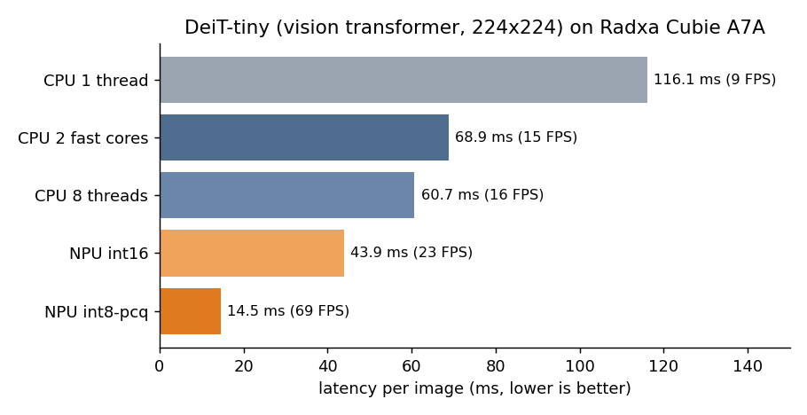

# DeiT-tiny (vision transformer) on the Radxa Cubie A7A NPU

A small vision transformer (DeiT-tiny, distilled, 224x224, ImageNet-1k, ~5M parameters) running on the Allwinner A733 NPU. I did this to find out whether a plain transformer, with LayerNorm, softmax and GELU, goes through the Acuity converter and runs well on this NPU. It does, after two fixes (below), and int8 is about 4x faster than the board's CPU.

## Results

Radxa Cubie A7A, batch 1, 224x224 input, 100-run averages.

| | time | FPS | agrees with float? |
|---|---|---|---|
| **NPU int8 (pcq)** `models/deit_tiny_int8pcq.nb` (7 MB) | **14.5 ms** | 69 | top-1 class same on 12 of 14 photos; float's top-1 always inside the quantised top-5; logit correlation 0.977 |
| **NPU int16** `models/deit_tiny_int16.nb` (12 MB) | 43.9 ms | 23 | top-1 same on 14 of 14; correlation 1.000 |
| CPU, 1 thread (onnxruntime fp32) | 116 ms | 9 | reference |
| CPU, 2 fast cores | 69 ms | 15 | reference |
| CPU, 8 threads | 61 ms | 16 | reference |

For scale, an Intel i3-1005G1 laptop runs it in 17.8 ms.



The 14 test photos were hand photos, not ImageNet pictures, so I only measured how well the NPU agrees with the float model, not real classification accuracy. (ImageNet has no "hand" class, which is why a thumbs-up photo comes out as "Band Aid" in all of them, float included.) The calibration set was 47 centre-cropped photos of scenes and hands, also not ImageNet.

## What I used

- **Board:** Radxa Cubie A7A (Allwinner A733, 8x Cortex-A55, VeriSilicon Vivante NPU), Debian 11, kernel 5.15.147-a733. The NPU is driven through VIPLite with the `awnn_inference` wrapper that was already installed on my board (`~/awnn_inference`).
- **Converter:** the NPU toolchain docker image `ubuntu-npu:v2.0.10.1` (Acuity 6.30.22 + Vivante IDE 5.11), for the Allwinner A733 NPU. I didn't build it and I'm not redistributing it, so check Radxa's NPU documentation for where to get it. Everything below that says "in the container" runs there, with this repo mounted at `/workspace/mp` (for example `docker run -v $PWD:/workspace/mp ...`). The scripts assume that path.
- **Tools on the board:** `scripts/nb_bench.cpp` is a small timing / smoke-test program I wrote for `.nb` files. Build it on the board:

```
g++ -O2 -std=c++14 -pthread scripts/nb_bench.cpp -I ~/awnn_inference/include -L ~/awnn_inference/install/lib \
    -lawnn_inference -lNBGlinker -lVIPhal -Wl,-rpath,$HOME/awnn_inference/install/lib -o ~/nb_bench/nb_bench
export LD_LIBRARY_PATH=$HOME/awnn_inference/install/lib
~/nb_bench/nb_bench -m model.nb -n 100                      # latency with random input
~/nb_bench/nb_bench -m model.nb -n 1 -i0 input.bin -o out.bin   # real input (raw bytes), outputs saved as float32 (out.bin, out.bin.1, ...)
```

`scripts/board_eval.sh` wraps that: copy a model and a folder of `*.in.bin` files to the board, run them all, copy the outputs back.

## Classify a photo on the board

```
python3 scripts/classify.py photo.jpg --nb models/deit_tiny_int8pcq.nb --labels config.json --bench ~/nb_bench/nb_bench
```

`config.json` is the model's config (it has the 1000 class names; `scripts/get_model.sh` downloads it). The `.nb` takes raw uint8 RGB 224x224 HWC (resize the short side to 224, centre-crop) because the ImageNet mean/std normalisation is inside the network. Output is 1000 float logits.

## How I converted it

Source model: [Xenova/deit-tiny-distilled-patch16-224](https://huggingface.co/Xenova/deit-tiny-distilled-patch16-224), an ONNX export of `facebook/deit-tiny-distilled-patch16-224` (`scripts/get_model.sh`).

The raw ONNX did not go straight through. `scripts/prepare.sh` runs the fixes in the container:

1. **Shape arithmetic.** The export is full of `Shape -> Gather -> Unsqueeze -> Concat -> Reshape` chains from dynamic shapes. Acuity rejects them. `onnxsim` alone did not remove them, even with a fixed input size, because the *output* batch dimension was still symbolic. `vit_prep.py` pins everything to batch 1 and 224x224 (and sets `ir_version` 8, since the container's ONNX is old), `onnxsim` runs, then `vit_fold.py` replaces the remaining `Shape` nodes by constants using shape inference, then `onnxsim` again. 100 -> 0 shape ops.
2. **GELU's `Erf`.** I wasn't sure Acuity would accept `Erf`, so `vit_erf.py` replaces it with `tanh(1.13 z + 0.1 z^3)`. The fit error is at most 0.0004; on random input the logits of the patched model correlate at 0.99998 with the original and give the same top-1. I did not test whether plain `Erf` would have imported.
3. **Normalisation on the NPU.** ImageNet mean `123.675 116.28 103.53`, scale `0.017125 0.017507 0.017429` per channel in the input meta (`scripts/mp_convert_onnx.sh` takes them as arguments).
4. **Convert:** `bash scripts/mp_convert_onnx.sh vit deit_npu.onnx /workspace/mp/calib224v/dataset.txt "123.675 116.28 103.53" "0.017125 0.017507 0.017429" pcq i16`. The calibration list is a `dataset.txt` of 47 224x224 PNGs.
5. **Check:** `scripts/vit_ref.py` (float reference + raw inputs from `images/`; `scripts/get_images.sh` downloads a few), `scripts/board_eval.sh`, then `scripts/vit_cmp.py`.

After those, Acuity imported the LayerNorm (as ReduceMean/Pow/Sqrt/Div), softmax, MatMul and Gemm ops with 0 errors, and the int8 and int16 exports both compiled first time.

## Caveats

- Batch 1, fixed 224x224. No other sizes tried.
- Accuracy numbers are agreement with float on 14 photos, nothing more.
- It is a tiny model. I did not try anything bigger (DeiT-small/base, Swin, ...).
- I did not measure power.

## Things that cost me time (Acuity / A733 in general)

These are not specific to this model, so if you convert something else you will probably hit them too.

1. **Export for the right chip.** `--optimize VIP9000NANODI_PLUS_PID0X1000003B` is the A733. An older target I tried first (`VIP9A00NANOQI_PID0X10001029`) gave empty `.nb` files and "Fatal model generation error".
2. **Use `pegasus_patched.py`.** The plain `pegasus.py` in my container failed because there was no torch installed. `env.sh` sets `$PEG` to the patched one.
3. **Put the normalisation on the NPU.** In the input meta I set `add_preproc_node: true`, `reverse_channel: false` and per-channel mean/scale, so the board feeds raw uint8 RGB. Same for the output: `add_postproc_node: true` gives you float32 outputs, which is all the wrapper's output reader understands.
4. **`reverse_channel: false` matters.** The generated default is `true`, which silently flips the channel order of the calibration data. For images that just hurts accuracy a bit; for non-image tensors it scrambled everything (see the SmolLM2 repo).
5. **Always compare the quantised simulator with the float model before trusting a `.nb`**, and then compare the board with the simulator. They do not always agree (see the palm detector below).
6. **Quantisation choice is per model.** int8 per-channel (`pcq`) is fast and fine for some networks, wrecks others; `int16` (`dynamic_fixed_point`) is about 1.5-3x slower but usually close to lossless.

## Credits

DeiT: Touvron et al., [facebookresearch/deit](https://github.com/facebookresearch/deit) (Apache-2.0). ONNX export by Xenova.

## Use it from Python

There is now a pip-installable Python wrapper for the NPU, [cubie-npu](https://github.com/Aseel1206/cubie-npu) (not on PyPI yet, install it with `pip install git+https://github.com/Aseel1206/cubie-npu`). With it you can skip the C++ tools above:

```python
from cubie_npu import Model
logits = Model("models/deit_tiny_int8pcq.nb")(rgb_224x224_uint8)     # 14.6 ms, float32 logits
```

[`examples/classify.py` in cubie-npu](https://github.com/Aseel1206/cubie-npu/blob/main/examples/classify.py) is a complete script (it gives bit-identical results to `scripts/classify.py` here).

## More models on the Cubie A7A NPU

Same board, same toolchain, same kind of notes:

- [cubie-npu](https://github.com/Aseel1206/cubie-npu): Python bindings for the NPU
- [radxa-cubie-a7a-npu-mediapipe-hands](https://github.com/Aseel1206/radxa-cubie-a7a-npu-mediapipe-hands): MediaPipe palm detector + hand landmarks (int8, ~5 ms total)
- [radxa-cubie-a7a-npu-blazeface](https://github.com/Aseel1206/radxa-cubie-a7a-npu-blazeface): MediaPipe BlazeFace face detector (~1 ms)
- [radxa-cubie-a7a-npu-depth-anything-v2](https://github.com/Aseel1206/radxa-cubie-a7a-npu-depth-anything-v2): Depth Anything V2 small depth estimation (255 ms int8)
- [radxa-cubie-a7a-npu-llm-smollm2-135m](https://github.com/Aseel1206/radxa-cubie-a7a-npu-llm-smollm2-135m): SmolLM2-135M chat (~23 tokens/s)
- [fast-acvnet-radxa-npu](https://github.com/Aseel1206/fast-acvnet-radxa-npu): stereo depth

## Licence

The scripts and docs here are MIT (see `LICENSE`). The neural networks are not mine and keep their own licences; check the model card of the original before reusing a converted `.nb`.
